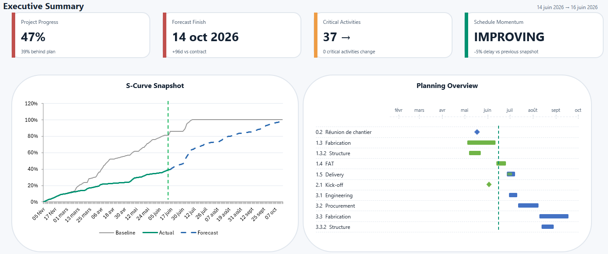
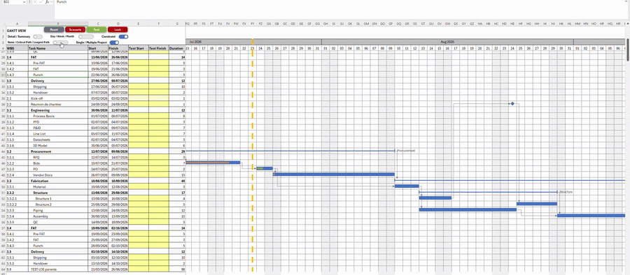
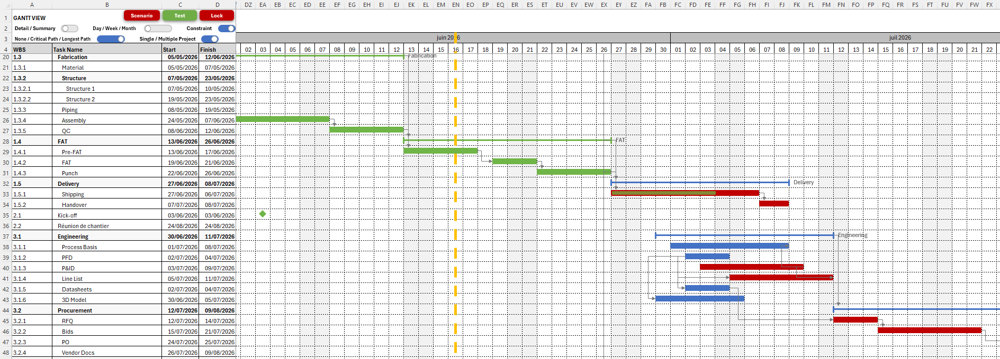
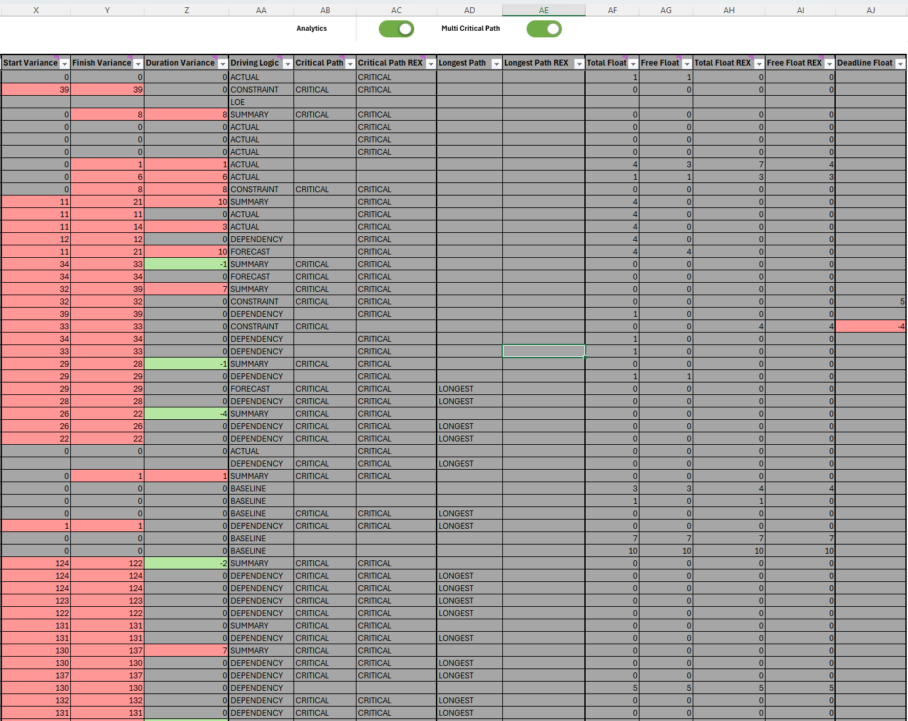
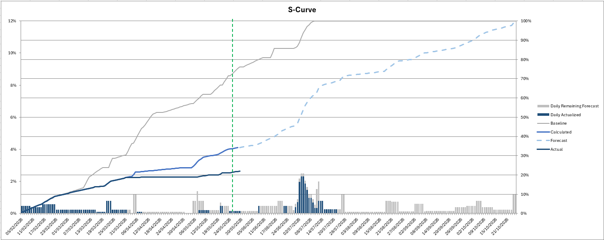
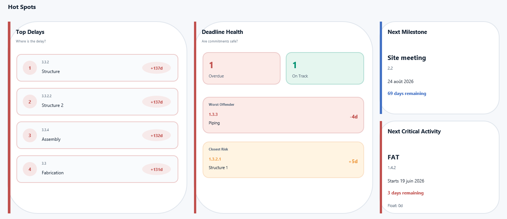
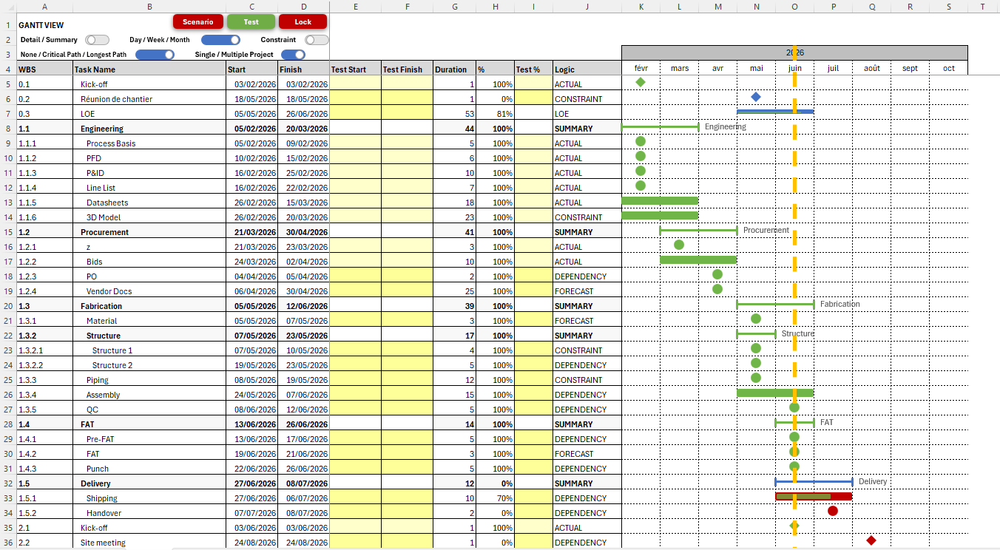
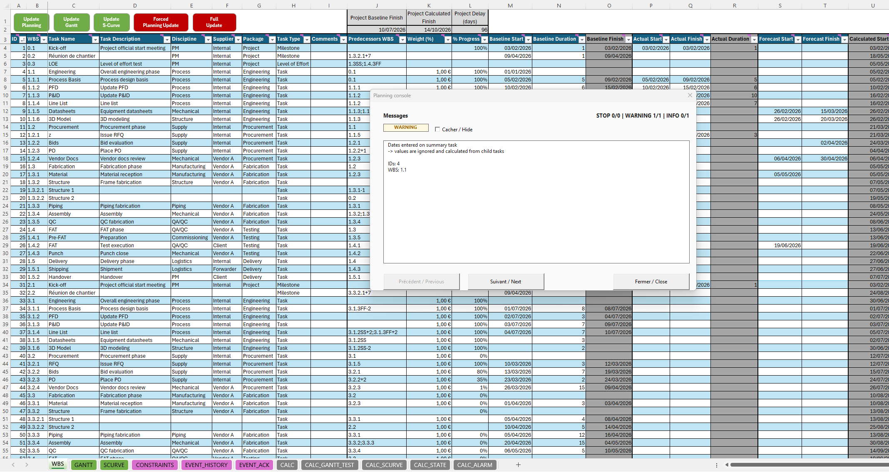
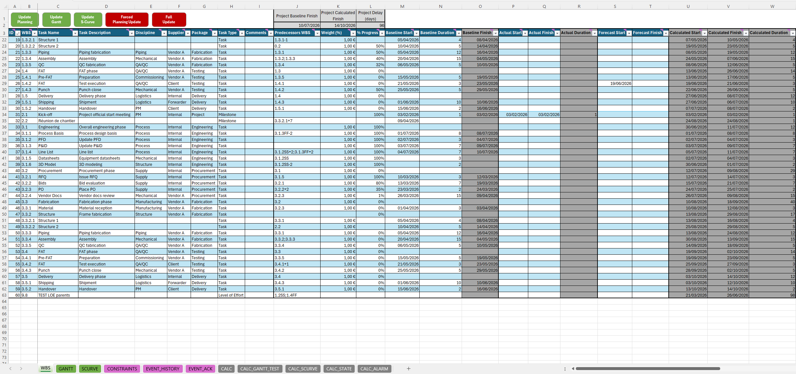

<div align="center">

# ProjectEngine

## Real scheduling. Native Excel.

**An open-source, dependency-driven scheduling and project controls engine with multi-project financial reporting for Microsoft Excel.**

[](https://github.com/TMailletFR/ProjectEngine/releases/latest)
[](LICENSE)
[](https://github.com/TMailletFR/ProjectEngine/stargazers)
[](https://github.com/TMailletFR/ProjectEngine/issues)

[**Download the latest release**](https://github.com/TMailletFR/ProjectEngine/releases/latest) ·
[**English documentation**](Docs/en/README.md) ·
[**Documentation française**](Docs/fr/README.md) ·
[**Report an issue**](https://github.com/TMailletFR/ProjectEngine/issues/new)

<br>



<br><br>

### See the schedule react



*Drag a task. See the schedule propagate, the critical path change, and the calculated plan return with Reset.*

</div>

---

## A Gantt chart should calculate the schedule — not just draw it

Most Excel Gantt templates are static timelines.

They can display dates and colored bars, but they do not understand the logic connecting activities. When one task slips, successors must be checked manually. Critical activities can change without warning. Floats, deadlines, progress curves and reporting can quietly become inconsistent.

**ProjectEngine turns the workbook into a real scheduling system.**

Define the WBS, dates, progress, calendars, constraints and dependencies. ProjectEngine calculates the network, propagates changes, identifies the Critical and Longest Paths, measures float, surfaces planning risks and keeps the Gantt, analytics, Dashboard and S-Curve aligned. Add activity budgets, expense journals and multi-project financial reporting without leaving the workbook.

All inside the Excel environment your organization already uses — with a dedicated ProjectEngine Ribbon tab, guided project setup, and no separate add-in.

---

## What happens when one activity slips?

| Static Excel Gantt | ProjectEngine |
| --- | --- |
| Successor dates are reviewed manually | Dependency logic propagates the change |
| Critical activities may be missed | Critical and Longest Paths are recalculated |
| Float is absent or maintained separately | Total and Free Float are recalculated |
| Conflicts can remain hidden | Structured `INFO`, `WARNING` and `STOP` diagnostics identify them |
| Reporting can drift away from the schedule | Gantt, analytics, Dashboard and S-Curve consume the same calculated planning data |
| Alternatives require duplicated workbooks | TEST and SCENARIO workflows evaluate changes before they are applied |

> **Most Excel Gantt templates draw schedules. ProjectEngine calculates them.**

---

## Built for complex project environments

ProjectEngine is designed for people who need a dependable planning model, not a decorative timeline:

- planning engineers and schedulers;
- project controls and PMO teams;
- project managers working primarily in Excel;
- engineering, EPC, construction and infrastructure projects;
- shipbuilding, manufacturing and industrial programmes;
- teams familiar with Microsoft Project or Primavera P6 but working without access to those licenses;
- organizations where Excel is available everywhere but additional software is not.

ProjectEngine can also distinguish criticality across multiple projects in the same workbook, supporting programme-level analysis rather than treating every activity as part of one undifferentiated schedule.

### Where it fits

ProjectEngine does **not** claim to replace every capability of Microsoft Project, Primavera P6 or a full enterprise project management suite.

It fills a different gap:

> **Professional dependency-driven scheduling for teams that need to remain in Excel.**

---

## Built into Excel — ready for everyday planning

ProjectEngine brings its main actions together in a **dedicated Excel Ribbon tab**, with embedded custom-icon commands, including Finance management and reporting. Controls adapt to the active sheet:

- **WBS:** Planning Update, Gantt Update, S-Curve Update, Forced Planning Update and Full Update.
- **Gantt:** TEST, SCENARIO, LOCK and Reset.
- **Navigation:** Show Full Timeline and Go to Selected Task, plus quick access to Settings, project import and the interactive tutorial.
- **Finance:** Manage Activities, Manage Expenses, Refresh Finance and Extract Finance.
- **Project management:** Planning Reset, Full Reset, history, acknowledgement and Dashboard cleanup actions.

The WBS and Gantt no longer need redundant worksheet command buttons. Ribbon labels and guidance are available in English and French. **No installation, external assets or additional user account is needed.**

### Start fresh or bring an existing project forward

An empty workbook offers **Start New Project**, **Import Previous Project**, or **Discover ProjectEngine** through the interactive tutorial. Users of older ProjectEngine versions can move supported WBS inputs, dependencies, dates, constraints, settings, warning acknowledgements, Dashboard snapshots, compatible event history and supported WBS input formulas into the newer workbook.

Import leaves the original source workbook unchanged and **does not recalculate the schedule automatically**. Review the imported WBS and Constraints, then choose Planning Update or Full Update. Import replaces supported project data in the destination workbook, so **keep a backup of the destination before importing**. Unsupported or incompatible data may be rejected rather than silently discarded.

### Track project costs and consolidate financial projects

**New in v1.5.0:** the integrated **FINANCE** and **FINANCE SUMMARY** worksheets add budgets, dated actual expenses and credits, Estimate to Complete (ETC), Estimate at Completion (EAC), variance, monthly and cumulative expenditure charts, and extractable Finance snapshots. Use **START**, **END**, or **LINEAR** to distribute planned costs across an activity’s schedule.

Finance supports multiple financial projects, independent or copied financial records, and shared records with **Global** consolidation that counts shared financial data once. A native Excel draft table supports filtering, sorting, direct editing and pasting of expenses, followed by explicit Confirm/Cancel. Future-dated expenses remain in the journal but are withheld from the actual chart until the appropriate reference date. **Refresh Finance** is explicit; ordinary Planning Update does not calculate Finance.

A workbook can support multi-project *scheduling criticality* and multi-project *financial consolidation*, but these are distinct capabilities; Global Finance does not merge separate schedules or workbooks. The Finance module is project cost reporting, not general ledger accounting, invoicing, or financial EVM/CPI/SPI.

### Learn inside Excel — interactive tutorial

A new **29-step interactive tutorial** helps users learn ProjectEngine without leaving the workbook. Open it from the welcome screen or the ProjectEngine Ribbon, and choose between two modes:

- **Discovery:** Explore the WBS, Gantt, analytics, S-Curve, Dashboard, Constraints and Event History without entering data or running calculations just to view a tutorial page.
- **Practice:** Enter real project data directly in Excel, run normal ProjectEngine commands when prompted, and learn from actual results and diagnostics. No demonstration project or separate calculation engine is inserted.

The tutorial highlights relevant workbook areas, stays open while you edit cells in Practice mode, and remembers progress separately for both modes. You can resume or restart either path. It is available in **English and French**.

### Clearer, modernized dialogs

The welcome screen, planning messages and tutorial now share a more consistent interface, with clearer buttons and improved spacing. Planning message windows adapt to their content: short messages stay compact, while longer messages use the available space and remain scrollable. Text can still be selected and copied, and normal warning acknowledgements are preserved.

### Navigate and update more efficiently

**Show Full Timeline** frames the available project timeline within Excel's zoom limits. **Go to Selected Task** navigates from a selected WBS or Gantt task to its rendered position, with support for milestones and summary tasks and without silently leaving Summary mode.

Full Update **still recalculates the entire schedule and analytics**. It now avoids rewriting calculated output columns that are already identical. This saves time especially on unchanged schedules; it does not mean a complete rebuild is inherently faster. Gantt rendering also reuses valid existing task graphics and dependency routes where possible, with a full rebuild retained for changes that require one.

---

## See the planning system

### Interactive, dependency-driven Gantt



Activities, summaries, milestones, Level of Effort tasks, constraints, dependencies, progress and critical-path overlays remain connected to the same scheduling model.

### Planning analytics



Review Critical and Longest Paths, Total and Free Float, Driving Logic, deadline exposure, schedule variance and multi-project criticality from a dedicated analysis layer.

### Financial project controls (v1.5.0)

FINANCE links selected WBS activities to budgets and a dated journal of actual expenses. FINANCE SUMMARY presents planned and actual costs monthly and cumulatively, for individual financial projects or consolidated Global reporting. Expenses may be positive or negative; future entries are retained without being treated as current actual spending on the chart.

The financial timeline is separate from the progress S-Curve: **START / END / LINEAR** are Finance budget profiles, not non-linear S-Curve distributions.

### S-Curve and workload distribution



Compare Baseline, Actual, Forecast and Calculated progress while viewing the time-phased workload behind the curves.

<details>
<summary><strong>More screenshots</strong></summary>

### Hot Spots analysis



### Month-scale Gantt



### Diagnostic console



### WBS planning inputs



</details>

---

## Core capabilities

<table>
<tr>
<td width="50%" valign="top">

### Scheduling engine

- dependency-driven scheduling;
- FS, SS and FF relationships;
- positive and negative lags;
- multiple predecessors;
- automatic schedule propagation;
- 5-day, 6-day and 7-day working calendars;
- milestones and Level of Effort activities;
- parent / child date rollups;
- cycle and missing-predecessor detection;
- hard constraints and deadlines.

</td>
<td width="50%" valign="top">

### Schedule intelligence

- Critical Path analysis;
- Longest Path analysis;
- Total Float and Free Float;
- Driving Logic;
- baseline and forecast variance;
- deadline float and deadline monitoring;
- delay and momentum analysis;
- parent-date and task-type warnings;
- multi-project criticality analysis.

</td>
</tr>
<tr>
<td width="50%" valign="top">

### Controlled simulation

- focused, non-destructive TEST mode;
- complete SCENARIO alternatives;
- LOCK workflow for applying validated results;
- drag-and-resize simulation from the Gantt;
- Day, Week and Month snapping;
- predictive rendering;
- transactional execution and controlled rollback.

</td>
<td width="50%" valign="top">

### Reporting and diagnostics

- Day, Week and Month Gantt views;
- executive Dashboard;
- planning Hot Spots;
- Baseline, Actual, Forecast and Calculated S-Curves;
- workload distribution;
- structured `INFO`, `WARNING` and `STOP` messages;
- Event History and Alarm History;
- warning acknowledgement and message navigation;
- project welcome screen, interactive tutorial and import from supported earlier versions;
- FINANCE and FINANCE SUMMARY for budgets, actual expenses, ETC/EAC and cost variance;
- multi-project financial consolidation, expense journal and monthly cash-flow charts.

</td>
</tr>
</table>

<details>
<summary><strong>View the complete feature set</strong></summary>

### Planning logic

- Baseline, Actual, Forecast and Calculated planning;
- single-source dependency-driven calculation;
- signature-based incremental recalculation;
- forced full recalculation when required;
- full and partial output synchronization;
- protected calculated-column lifecycle;
- canonical task identity and parsed-network contracts.

### Constraints and controls

- dedicated constraints table;
- hard-constraint calculation;
- deadline management;
- constraint-impact analysis;
- grouped dependency, constraint, cascade and upstream diagnostics;
- bilingual planning messages;
- stable event signatures;
- acknowledgement workflow.

### Visualization

- tasks, summaries, milestones and Level of Effort rendering;
- dependency links;
- progress, critical-path and longest-path overlays;
- constraints, deadlines and Today Line;
- fractional positioning in Week and Month scales;
- predictive Shape Registry;
- deterministic fallback and lazy geometry repair;
- independently refreshable Gantt, Dashboard and S-Curve outputs;
- Show Full Timeline and Go to Selected Task navigation;
- retained Gantt graphics and targeted dependency-route updates where valid.

### Finance and financial reporting (v1.5.0)

- WBS-linked financial activity selection and optional cost tracking;
- budget profiles START, END and LINEAR;
- dated expense ledger with signed credit adjustments;
- independent, copied and shared financial records across financial projects;
- Global totals without duplicate counting of shared records;
- native worksheet-based multi-entry expense drafting and explicit commit/cancel;
- monthly and cumulative planned and actual financial charts;
- future-dated expenses retained, with actual-chart cutoff at the last Finance refresh;
- explicit Finance refresh, extraction snapshots and independent FR/EN presentation;
- persistent Finance domain in workbook SchemaVersion 3, included in supported migration and Full Reset.

### Workbook lifecycle and safety

- embedded, context-sensitive Ribbon with custom icons;
- 29-step bilingual tutorial with Discovery and Practice modes;
- independent tutorial progress and contextual highlighting;
- guided project import from supported earlier workbooks;
- Planning Reset for project turnover;
- Full Reset for complete workbook cleanup;
- Safe Empty State for Gantt and S-Curve;
- guarded WBS write scopes;
- owner-controlled output writers;
- transactional simulation workflows;
- isolated validation on temporary workbook copies;
- deterministic regression harnesses;
- no competing calculation engines across planning, simulation or reporting.

</details>

---

## Get started

1. Visit the [latest release](https://github.com/TMailletFR/ProjectEngine/releases/latest) and download the prepared `ProjectEngine_*.xlsm` file under **Assets**.
2. Open it in **Microsoft Excel for Windows** and enable macros if you trust the downloaded workbook.
3. In the welcome screen, choose **Start New Project**, **Import Previous Project**, or **Discover ProjectEngine** to begin the interactive tutorial.
4. For a new project, follow the **Discovery** tour to explore the workbook or **Practice** to enter real data with guidance. You can also use the integrated Quick Start guide in WBS.
5. For an import, choose a supported older ProjectEngine file and **review the transferred WBS, Constraints, settings and any supported Finance data** before calculating.
6. Run **Planning Update** from the ProjectEngine Ribbon to calculate and publish the schedule. Use **Full Update** when you want a complete recalculation and the associated reporting workflow.
7. Review diagnostics and explore the Gantt, analytics, Dashboard and S-Curve. Use **Go to Selected Task** or **Show Full Timeline** to navigate the Gantt.
8. For cost reporting, use **Manage Activities**, enter budgets and expenses under FINANCE, then explicitly run **Refresh Finance** and review FINANCE SUMMARY.

The interactive tutorial and WBS onboarding are available in **English and French**. WBS also provides Required / Optional / Calculated field indicators, contextual column help and an integrated Quick Start guide. The Ribbon and workbook support global or per-area language preferences.

> **v1.5 migration:** Compatible prior-version workbooks can be imported into the SchemaVersion 3 workbook; the import preserves supported financial-domain data, WBS input-cell formatting and column widths where available. Existing workbooks without Finance data remain supported. Source macros are not executed; the source is kept intact.
>
> **Upgrading an existing project?** Import replaces supported data in the **destination** workbook. Keep a backup of that destination before starting. The selected source is opened read-only and is not modified. Derived calculations, old Gantt graphics and TEST/SCENARIO states are not imported; rebuild the required views after reviewing the inputs.
>
> Download the prepared `.xlsm` asset from the release page. GitHub's automatically generated **Source code** archives are not ready-to-use Excel workbooks.

---

## Typical planning workflow

```text
Welcome: Start New / Import Previous / Discover
   ↓
WBS inputs
   ↓
Planning Update
   ↓
Dependency network + calendars + constraints
   ↓
Calculated dates + rollups + schedule analytics
   ↓
Diagnostics
   ↓
Gantt · Dashboard · S-Curve · Planning Analytics
   ↓
Optional Finance: Manage Activities / Expenses → Refresh Finance → FINANCE SUMMARY
   ↓
TEST / SCENARIO simulation
   ↓
Review and LOCK validated changes
```

1. Build the WBS and define task types, calendars, dates, progress and dependencies.
2. Add hard constraints or deadlines when required.
3. Run Planning Update.
4. Resolve any blocking `STOP` diagnostics and review `WARNING` or `INFO` messages.
5. Analyze Critical and Longest Paths, float, Driving Logic, deadlines and project health.
6. Evaluate focused changes in TEST mode or create a complete SCENARIO.
7. Review predictive differences before applying validated results with LOCK.
8. Refresh the reporting view needed for the next planning or management review.

---

## Why the results remain consistent

ProjectEngine is not a collection of disconnected worksheet macros.

The scheduling engine is the **single source of truth**. Simulation, diagnostics, visualization and reporting reuse its outputs rather than implementing their own competing date logic.

| Domain | Responsibility |
| --- | --- |
| Runtime workflow | Macro lifecycle, nesting, controlled abort and deferred display |
| WBS / DataSync | User inputs and synchronization into canonical calculation tables |
| Core calculation | Network logic, calendars, constraints, activity dates, LOE and rollups |
| Analytics | Critical / Longest Path, float, deadlines, variance and schedule health |
| Output writers | Controlled full or partial publication to protected workbook outputs |
| Gantt | Timeline refresh, rendering, geometry, interaction and drag simulation |
| Simulation | TEST, SCENARIO and LOCK services using the existing Core |
| Dashboard / S-Curve | Executive reporting and time-phased progress analytics |
| Finance | WBS-linked budgets, financial records, dated expense journal, individual/Global projections; explicit refresh |
| Diagnostics | Message preparation, console policy, history, alarms and acknowledgement |
| Canonical contracts | Shared identity, parsed network and incremental-calculation contracts |

This separation makes the workbook easier to validate, maintain and extend without weakening the determinism of the planning model.

For the full technical design:

- [English architecture and maintenance documentation](Docs/en/README.md)
- [Documentation française — architecture et maintenance](Docs/fr/README.md)

---

## Project status

**Stable.**

ProjectEngine reached its first stable baseline with v1.0.0. The scheduling engine, simulation workflows, diagnostics, Gantt rendering, analytics, Dashboard, S-Curve, localization, reset workflows and guarded workbook lifecycle are operational and protected by permanent validation harnesses.

The project remains actively maintained. v1.5 adds Finance and Finance Summary, multi-project financial consolidation, expense management, SchemaVersion 3 migration, and reliability improvements to Dashboard, S-Curve, import and Full Reset. The 29-step tutorial, redesigned dialogs, embedded Ribbon and Gantt navigation remain available. Future development is driven by real planning use cases, reported issues and community feedback.

- [Latest release](https://github.com/TMailletFR/ProjectEngine/releases/latest)
- [All releases](https://github.com/TMailletFR/ProjectEngine/releases)
- [Open issues](https://github.com/TMailletFR/ProjectEngine/issues)
- [Questions, feedback and real-world use cases](https://github.com/TMailletFR/ProjectEngine/discussions/2)
- [Suggest what ProjectEngine should support next](https://github.com/TMailletFR/ProjectEngine/discussions/3)
- [Getting started and setup questions](https://github.com/TMailletFR/ProjectEngine/discussions/4)

---

## Feedback shapes the roadmap

The original feature backlog has reached a mature state. The next useful improvements should come from planners, project controls professionals and teams using ProjectEngine on schedules the project has not encountered yet.

Useful contributions include:

- a planning workflow that is difficult to represent;
- a missing relationship, calendar or reporting need;
- an unexpected result on a real schedule;
- an onboarding point that was unclear;
- a performance issue on a large programme;
- a feature you rely on in Microsoft Project or Primavera P6 but miss in Excel.

Choose the most useful entry point:

- [Questions, feedback and real-world use cases](https://github.com/TMailletFR/ProjectEngine/discussions/2) for general discussion and experience reports;
- [What should ProjectEngine support next?](https://github.com/TMailletFR/ProjectEngine/discussions/3) for missing workflows and feature ideas;
- [Getting started with ProjectEngine](https://github.com/TMailletFR/ProjectEngine/discussions/4) for setup, inputs and first-use questions;
- [GitHub Issues](https://github.com/TMailletFR/ProjectEngine/issues) for reproducible bugs and changes that need formal tracking.

When reporting an issue, remove confidential or company-specific data before sharing any workbook or screenshot. Excel may retain document metadata when saving; review both project content and metadata before publishing a file.

---

## Frequently asked questions

<details>
<summary><strong>Is ProjectEngine just another Excel Gantt template?</strong></summary>

No. A template mainly visualizes dates. ProjectEngine calculates a dependency network, propagates schedule changes, analyzes path and float, manages constraints, supports simulations and keeps its reporting layers aligned with calculated planning outputs.

</details>

<details>
<summary><strong>Does ProjectEngine replace Microsoft Project or Primavera P6?</strong></summary>

Not in every use case, and it does not claim to. Dedicated scheduling platforms cover broader enterprise, resource and portfolio requirements. ProjectEngine is designed for teams that need genuine scheduling capabilities while remaining inside Excel.

</details>

<details>
<summary><strong>Do users need to know VBA?</strong></summary>

No. The released workbook is intended to be used through its Excel sheets, controls and integrated onboarding. VBA knowledge is only relevant for people who want to inspect, maintain or extend the source.

</details>

<details>
<summary><strong>Can it manage more than one project?</strong></summary>

Yes. ProjectEngine includes multi-project scheduling criticality analysis and, since v1.5, a separate **multi-project Finance domain**. Financial projects can use independent, copied or shared records, with a Global consolidated view that counts shared financial data once. This does not combine independent scheduling workbooks automatically.

</details>

<details>
<summary><strong>Does ProjectEngine track budgets and actual project costs?</strong></summary>

Yes. FINANCE supports task-linked budgets, expense/credit entries, ETC, EAC and variance. FINANCE SUMMARY presents monthly and cumulative budget/actual charts; select **Refresh Finance** to calculate financial outputs explicitly. The module does not provide full accounting, billing or earned-value financial KPIs.

</details>

<details>
<summary><strong>Can I test a delay without changing the live WBS?</strong></summary>

Yes. TEST mode supports focused non-destructive changes, while SCENARIO mode supports complete schedule alternatives. Validated simulation results can be applied through the controlled LOCK workflow.

</details>

<details>
<summary><strong>Which languages are supported?</strong></summary>

The interactive tutorial, workbook onboarding, Ribbon commands and planning messages support English and French, with global and per-area language controls.

</details>

<details>
<summary><strong>How do I learn to use ProjectEngine?</strong></summary>

Open **Tutorial** from the ProjectEngine Ribbon or **Discover ProjectEngine** from the welcome screen. Choose **Discovery** for a guided tour without calculation or data entry, or **Practice** to enter real project data and follow the normal scheduling workflow. Both modes have their own saved progress and can be restarted. The tutorial is available in English and French.

</details>

<details>
<summary><strong>Can I upgrade an older ProjectEngine project without re-entering every task?</strong></summary>

Yes. Open the newer workbook and choose **Import Previous Project** from the welcome screen or Ribbon. Supported WBS inputs, constraints, settings, acknowledgements, historical Dashboard snapshots and supported Finance records can be transferred. Supported WBS input formatting and column widths can also be preserved. Import does not execute the older workbook's VBA or copy its calculated Gantt/S-Curve outputs. Review the imported inputs and run the planning update yourself. **Back up the destination workbook first**; the original source remains unchanged. Some custom formulas or unsupported structures may be refused.

</details>

<details>
<summary><strong>Does Full Update always rebuild everything in Excel?</strong></summary>

Full Update **always runs a complete schedule and analytics recalculation**. However, if calculated output columns already match, ProjectEngine can leave those Excel cells untouched instead of rewriting them. A genuinely new or substantially changed schedule still requires the necessary work; Full Update is not a substitute for incremental Planning Update.

</details>

<details>
<summary><strong>Do I need to install a Ribbon add-in?</strong></summary>

No. The ProjectEngine Ribbon and its custom icons are included in the downloadable `.xlsm` workbook. You do need a supported desktop Excel environment with VBA macros enabled.

</details>

<details>
<summary><strong>Where should I download ProjectEngine?</strong></summary>

Use the prepared `.xlsm` workbook attached to the [latest GitHub release](https://github.com/TMailletFR/ProjectEngine/releases/latest). Do not use GitHub's automatically generated source archives when you want the ready-to-run workbook.

</details>

---

## Contributing

ProjectEngine welcomes:

- bug reports with clear reproduction steps;
- feature requests grounded in a real planning need;
- usability and documentation feedback;
- anonymized test cases;
- code contributions that preserve the single-source scheduling architecture and existing public workbook contracts.

Before proposing code changes, review the architecture and maintenance documentation:

- [English documentation](Docs/en/README.md)
- [Documentation française](Docs/fr/README.md)

For substantial changes, open an issue or discussion first so the planning rule, compatibility impact and validation strategy can be agreed before implementation.

---

## Support ProjectEngine

The most useful ways to support the project are:

1. **Star the repository** so more Excel and project-controls users can discover it.
2. **Share it** with a planner, scheduler or project manager who is maintaining a complex schedule manually.
3. **Report feedback** after testing it on a real, non-confidential planning case.
4. **Contribute** an issue, use case, documentation improvement or validated change.

If ProjectEngine saves you meaningful time and you would also like to support its continued development:

<div align="center">

</div>

---

## License

ProjectEngine is released under the [GNU General Public License v3.0](LICENSE).

You may use, study, modify and redistribute the project under the terms of that license. Derivative distributions must preserve the same license obligations.

---

<div align="center">

### Stop maintaining complex schedules by hand.

[**Download ProjectEngine**](https://github.com/TMailletFR/ProjectEngine/releases/latest) ·
[**Star the repository**](https://github.com/TMailletFR/ProjectEngine) ·
[**Read the documentation**](Docs/en/README.md)

**Real scheduling. Native Excel.**

</div>
